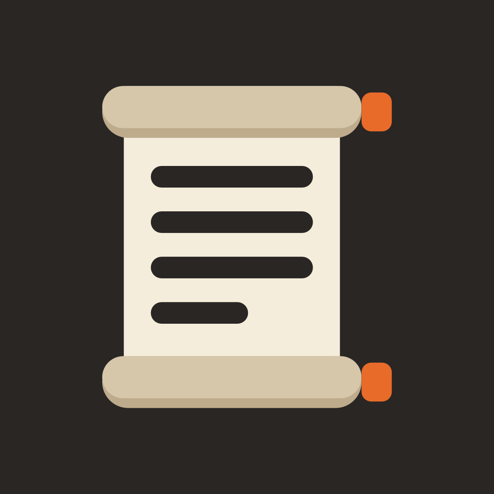

# Scrollkeeper

A simple ebook reader for Apple Watch. Your iPhone turns books into plain,
compact text; your watch stores hundreds of them and lets you read with the
Digital Crown.

It is made for reading text, not viewing documents: no page images, no PDF
rendering on the wrist, no accounts and no cloud.



## Features

**On the watch**
- **Crown scrolling:** one line per step, with a light tap every 5 lines instead of constant ticking.
- **Auto-scroll:** from 5 to 120 lines a minute. While it runs, the crown changes the speed, and it pauses when you lower your wrist.
- **Full-screen text:** the clock and controls hide while you read. Tap to show them.
- **Text size:** adjustable from 10 to 24 pt, in a condensed system font (SF for Latin, PingFang for Chinese).
- **Chapters and bookmarks:** a contents list with the current chapter highlighted, plus bookmarks with a short excerpt. A book without chapters gets places to jump to, from 0% to 90%.
- **Remembers your place** in every book, shows how far you've read in the book list, and reopens the last book on launch.
- **Offline library:** books are stored on the watch and compressed with LZMA, so hundreds fit easily.

**On the iPhone**
- **Imports** `.txt`, `.md`, `.epub` and `.pdf` from the Files app and sends them to the watch.
- **Share sheet:** share a file to Scrollkeeper from Files, Safari, Mail and other apps.
- **Shows each book's status:** converting, waiting for the watch, on the watch, or why it couldn't be read.
- **Manages the watch's books:** lists what is on the watch with how far each has been read, and deletes books from there.
- **Cleans up text for a small screen:** re-flows hard-wrapped lines, drops blank lines, splits very long paragraphs and detects older Chinese encodings such as GBK.
- **Finds chapters** from an EPUB's table of contents, PDF bookmarks, Markdown headings, and headings such as `Chapter 12` or `第十二章`. Printed contents pages are not mistaken for chapters.
- **PDF:** reads the text layer, removes running headers and page numbers, and re-joins paragraphs across pages. Scanned pages are read with Apple's on-device text recognition (Vision), in Chinese and English. Nothing is uploaded, and Apple Intelligence is not required.
- **DRM:** copy-protected EPUBs from stores are refused, with a message saying why.

## Requirements

- iPhone with iOS 26 or later
- Apple Watch with watchOS 11 or later
- Xcode 26 to build

## Building and installing

There are no third-party dependencies.

1. Open `Scrollkeeper.xcodeproj` in Xcode.
2. **Set up signing:** for both targets, open **Signing & Capabilities** and choose your own Team. If you are not the original author, change the bundle identifiers to something you own, too: the iPhone app's ID and the watch app's ID, which must start with it, plus the watch app's *WKCompanionAppBundleIdentifier* build setting.
3. **iPhone:** select the **Scrollkeeper** scheme and your iPhone, then Run. The first time, trust the developer on the phone under **Settings → General → VPN & Device Management**.
4. **Watch:** select the **Scrollkeeper Watch App** scheme and your Apple Watch, then Run. Running the watch scheme directly also registers the watch with your provisioning profile.

## Using it

1. On the iPhone, tap **Send Books to Watch** and pick one or more files, or share a file to Scrollkeeper from another app.
2. On the watch, open Scrollkeeper and pick a book. Swipe left on a book to delete it, there or in the iPhone's list. A short guide is already there the first time you open the app.
3. While reading:
   - Turn the crown to scroll.
   - Tap the text to show the controls: text size, auto-scroll and its speed, and the reading position.
   - With the controls showing, the list button at the top opens chapters and bookmarks.

## How it works

The iPhone does all of the parsing. Each book becomes a list of paragraphs,
one per line, with chapter headings marked by a `U+0001` prefix. The list is
compressed with LZMA and sent with WatchConnectivity. The watch only
decompresses and displays, so it stays fast and simple. It tells the iPhone
which books it has and how far each has been read; the iPhone sends back
requests to delete.

```
Phone/      iPhone app: file picker, EPUB and PDF import, sending to the watch, the watch's book list
Watch/      Watch app: library, reader, contents and bookmarks, built-in guide
Shared/     Book format and text clean-up used by both apps, the icon, privacy manifest
AppStore/   Store listing text and screenshots
```

## Privacy

Scrollkeeper collects nothing. See [PRIVACY.md](PRIVACY.md).

## Not supported

- MOBI/AZW and other formats. Convert them to EPUB first, for example with Calibre.
- Copy-protected (DRM) books.
- Images, tables and rich formatting. Only text and chapter headings are kept.

## License

MIT. See [LICENSE](LICENSE).
